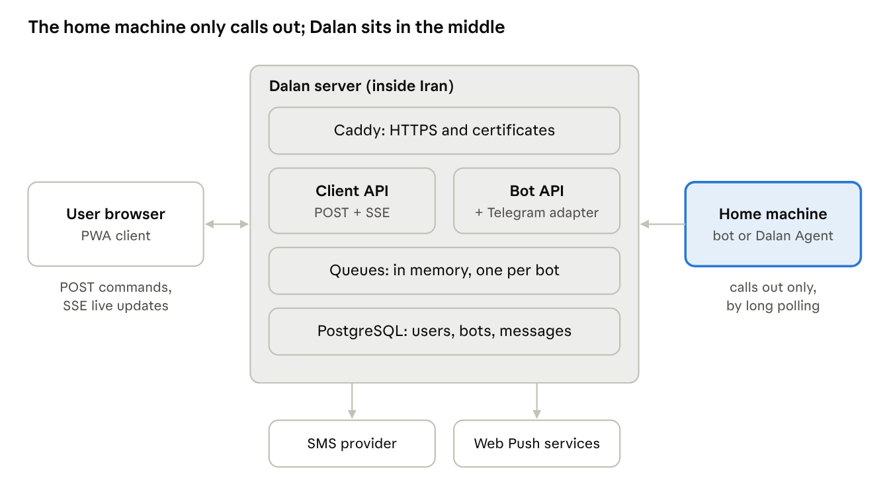

# Dalan — Design Document

Nov 16, 2026 · Behzad Khosravifar

## 1. Summary

Dalan (دالان, "corridor") is a relay platform hosted inside Iran that lets a developer run a bot or web app from a home or office computer, with no public IP and no rented server. The main site is `dalanet.ir`.

The home machine only makes outbound calls to Dalan. Users talk to Dalan. Dalan passes each request to the home machine and returns the answer, matched by a request ID.

**The problem.** Many developers in Iran can build an app but cannot run it online. They struggle with servers, DevOps, SMS login and international services that get filtered, sanctioned or cut off.

**Goals, in priority order:**

1. Bots and apps keep working without international internet.
2. No heavy server cost for the builder: the real compute stays on the home machine.
3. A home or office machine can serve the public, including data from a private network (for example a company's internal Jira and GitLab).

**Guiding rules for every decision:**

- Remove DevOps work from the builder. The best setup step is the one that does not exist.
- Be AI-friendly. Most builders will use an AI coding agent to connect their project.
- KISS and YAGNI. Build one layer at a time, and only what the current layer needs.
- Be honest in public about what Dalan can and cannot protect.

## 2. Product pillars

Dalan is four products that share one account system. The tunnel alone is a commodity; the value is in the combination.

| Pillar | What the builder gets | When |
| --- | --- | --- |
| Relay | A home machine with no public IP serves users through Dalan | Version 1 (bots), Layer 2 (web requests) |
| Hosting | The app's site runs on a Dalan subdomain or the builder's own domain | Layer 2 |
| Identity | Every user is verified once by Iranian mobile number; apps get real, unique users without building SMS login | Version 1 (bots), Layer 2 ("Login with Dalan") |
| Payments | Platform credit that apps can charge or give to users | Later, when there are paying customers |

Identity is likely the easiest pillar to sell. SMS OTP login is a real pain for small builders in Iran today.

## 3. Users, roles and rollout

| Role | Who | Can do |
| --- | --- | --- |
| User | Anyone with a verified Iranian mobile number | Start bots, press buttons, send messages and files, get notifications |
| Builder | A user with a verified email and admin approval | Create bots, get tokens, set limits inside what the admin allows, list a bot in the showcase |
| Bot | A program on the builder's machine, known by its token | Read updates, send and edit messages |
| Admin | The platform owner | Approve builders, set every limit, suspend users and bots, review showcase entries |

**Rollout phases:**

1. **Personal tool.** The owner and his own bots (ArcaneBot first).
2. **Known apps.** A few apps from people he knows: Valorians (a friend's game), Levelwise.
3. **Public.** Builders who can write an app, often with AI, but have no backend or DevOps skills.

The service is free for now. Registration is public from day one because the domain is public, so abuse protection is part of version 1.

## 4. Scope

Work is split into three layers. Version 1 is Layer 1 only.

| Layer | Contents | Status |
| --- | --- | --- |
| 1. Button bots | Private chat between a user and a bot: text, reply buttons, inline buttons, commands, pin, files. Long polling and webhook for bots. PWA client, SMS login, Web Push, admin dashboard. Telegram adapter for these features. | Build now |
| 2. Sites | Hosting an app's site, the Dalan Agent, the optional SDK, custom domains, "Login with Dalan", Telegram Mini App compatibility. | Designed here, build after Layer 1 works |
| 3. Extras | Payments and credit. | Ideas only |

**Not in scope, by decision:**

- No chat between users, no groups, no channels. Dalan only connects a user to a bot or app.
- No end-to-end encryption in version 1.
- No Telegram features that Dalan has no concept for: Stars, stickers, inline mode, the old Games API, Passport, business accounts.
- No support for old Telegram Bot API versions. Dalan takes one snapshot of the newest version.
- No Kafka, Redis or Orleans until a second server is needed.
- No WebSocket relay in the first version of Layer 2.

## 5. Architecture of version 1

Version 1 is one ASP.NET Core program on one server in Iran, with PostgreSQL beside it and Caddy in front.

Both the browser and the home machine open connections to Dalan; Dalan never opens a connection to the home machine.

The parts in the picture:

- **User browser (PWA client):** sends commands by POST and receives live updates by SSE.
- **Dalan server (inside Iran):** Caddy (HTTPS and certificates), Client API (POST + SSE), Bot API with the Telegram adapter, in-memory queues (one per bot), PostgreSQL (users, bots, messages).
- **Home machine (bot, or the Dalan Agent in Layer 2):** calls out only, by long polling.
- **Outside services the server calls:** the SMS provider and the Web Push services.

**How one button press travels:**

1. The user taps a button. The browser sends a POST to the Client API.
2. The server saves the message and puts an update in that bot's in-memory queue.
3. The bot's open long-polling call returns with the update.
4. The bot does its work at home and calls `sendMessage`.
5. The server saves the reply and sends it to the browser over SSE, and also as a Web Push. The service worker shows the push only when the chat is not already in front (a locked phone often keeps its connection open on the server, so the server cannot know).

**Technology choices and why:**

| Part | Choice | Why |
| --- | --- | --- |
| Server | C# on .NET 11, ASP.NET Core, Kestrel | The work is network-bound, so any fast runtime is enough. The owner has used C# since 2007 and can maintain it without AI if the internet is down. .NET 11 shipped on 2026-11-10 (STS, supported to November 2028). |
| Bot connection | Long polling (and webhook for bots that have a server) | Outbound only, no public IP, near-zero delay. One open connection per bot costs a few KB in Kestrel. |
| Browser connection | POST for commands, SSE for live messages | Simpler than WebSocket; one direction is enough. |
| Queue | A small list per bot, in memory | Updates expire in about a minute, so they do not need a disk. (Not a `Channel`: an update must stay until the bot confirms it.) |
| Database | PostgreSQL, message content in `jsonb` | Users, bots and memberships are relational; message bodies are JSON. Kafka is the wrong tool for "last 50 messages of this chat", Redis keeps everything in RAM, MongoDB adds nothing over `jsonb`. |
| Front proxy | Caddy | Gets and renews HTTPS certificates by itself; later gives on-demand certificates for custom domains. |
| Client | PWA in plain TypeScript, no framework | Small, fast, installable, supports Web Push. |
| Deploy | One self-contained binary + systemd, no Docker | Docker Hub refuses Iranian IP addresses (section 14). |

**Service boundaries inside the one program:** Identity, Relay (core, with the Client API and Bot API doors), Notification (Push and SMS), Admin, plus the Telegram adapter as a plugin. The core never mentions Telegram. Details and decisions: `docs/ARCHITECTURE.md`.

## 6. Core concepts and data model

| Entity | Stored in | Key fields |
| --- | --- | --- |
| User | PostgreSQL | Numeric id (stable, the only identity bots see), verified phone, username, password hash, optional email, optional TOTP secret, role, per-user limits |
| Bot | PostgreSQL | Numeric id, unique username (used in `dalanet.ir/@name`), owner, token hash, name, description, icon, visibility (private by default), delivery mode (polling or webhook), per-bot limits, last-seen time |
| Membership | PostgreSQL | User, bot, state (active, stopped, blocked), start time, read position (for unread counts) |
| Message | PostgreSQL | Per-chat sequence number, bot, user, direction, content as `jsonb`, time, delivery state, pinned flag |
| Update | Memory only | Update id, type, payload, expiry time |
| Push subscription | PostgreSQL | User, endpoint, keys |
| Limits | PostgreSQL | Global defaults, with overrides per user and per bot |
| Audit log | PostgreSQL | Who did what, when (admin and security events) |
| Access log | PostgreSQL | Who (user or bot), real client IP address, source port, UTC time. Kept to answer legal complaints (section 10) |

**Rules that follow from the model:**

- A chat is exactly one user and one bot. There is no other kind of chat.
- A bot never receives a phone number unless the user explicitly shares it.
- The token is shown once at creation and stored only as a hash. Whoever holds the token is the bot.
- Message sequence numbers per chat let the client ask "give me everything after number X".

## 7. Bot API

Dalan has its own core API with its own names, plus a thin Telegram adapter so existing Telegram bots move by changing only the server address and the token.

**Core API.** Base address `https://api.dalanet.ir`, separate from the address users open. The token travels in the `Authorization` header. Operations: get updates (long polling), set or delete webhook, send, edit, delete and pin a message, send and get a file, set commands, answer a button action, get bot info.

**Telegram adapter.** A separate module that accepts Telegram-shaped calls (`https://api.dalanet.ir/bot<token>/<method>`, at the root, as Telegram has it) and translates them to the core. Most Telegram libraries let the developer change the API base address, so bot code stays untouched.

- Token format matches Telegram's (`<bot id>:<secret>`) so libraries accept it.
- JSON shapes follow the newest Telegram Bot API version at the time of building: **10.4** (2026-11-09), recorded in `openspec/specs/telegram`. Older versions are not supported.
- The two products may drift apart later. Only the adapter changes then.

**Adapter coverage in Layer 1:**

| Area | Methods and types |
| --- | --- |
| Bot info | `getMe` |
| Receiving | `getUpdates`, `setWebhook`, `deleteWebhook`, `getWebhookInfo`; update types `message` and `callback_query` |
| Sending | `sendMessage`, `sendPhoto`, `sendDocument`, `sendAudio`, `sendVoice`, `sendVideo`, `sendChatAction` |
| Changing | `editMessageText`, `editMessageReplyMarkup`, `deleteMessage`, `pinChatMessage`, `unpinChatMessage` |
| Buttons | `ReplyKeyboardMarkup`, `ReplyKeyboardRemove`, `InlineKeyboardMarkup`, `answerCallbackQuery` |
| Commands | `setMyCommands`, `getMyCommands` |
| Files | `getFile` and file download |
| Text | `parse_mode` HTML and MarkdownV2, message entities |

**Built in milestone 5:** `getMe`, `getUpdates` (type `message`, commands marked as `bot_command` entities), `sendMessage` with text and `ReplyKeyboardMarkup` / `ReplyKeyboardRemove`, `deleteWebhook` and `sendChatAction` (both answer `true`). `parse_mode` is accepted and ignored for now: the text is shown as sent. The rest of the table comes with milestone 6 (rich messages, in the core first) and a later webhook change.

**Built in milestone 6:** update type `callback_query`, `sendPhoto`, `sendDocument`, `sendAudio`, `sendVoice`, `sendVideo` (upload or `file_id`), `editMessageText`, `editMessageReplyMarkup`, `deleteMessage`, `pinChatMessage`, `unpinChatMessage` (one pin per chat), `InlineKeyboardMarkup` with `callback_data` and `url` buttons, `answerCallbackQuery`, `setMyCommands`, `getMyCommands`, `getFile` and the file download. Files are kept on the server disk for 30 days (setting). Still left: webhooks and formatting (`parse_mode`, entities).

Any other method returns a Telegram-shaped error (`ok: false` with a clear description such as "not supported by Dalan"), so the bot does not crash.

**Joining a bot.** The user opens the bot and presses Start. The bot receives a `/start` message with the user's Dalan id and name. The bot's own code decides what to do: a public bot welcomes everyone, a private bot answers only its owner. Dalan only says who the user is.

**Honest migration cost.** Bot code does not change, but user ids are Dalan's, not Telegram's. A bot with a user database starts with zero known users on Dalan.

## 8. Client app

The client is one PWA at `dalanet.ir`, served by the same server. Persian (right to left) is the first language, English the second.

**Screens:** landing page, login, list of the user's bots with unread counts, chat, showcase, account settings (password, two-step login, notifications), builder area (create bot, token, limits), admin dashboard.

**Chat screen:** message history, reply buttons under the input, inline buttons under a message, a pinned message bar, the command menu, file upload, and the bot's status at the top.

**Staying up to date uses two mechanisms together:**

1. **Live.** While the app is open, new messages arrive over SSE.
2. **Sync.** Every time the app opens or reconnects, it asks for all messages after the last sequence number it has. Nothing is lost if a notification never arrived.

**Web Push** covers the time the app is closed or the phone is locked. Phones suspend a browser tab soon after the screen locks (iOS almost at once, Android usually within minutes), so an open connection cannot be relied on.

- Uses the Web Push standard with VAPID keys and a service worker.
- Works on Android, and on desktop Chrome, Edge and Firefox (Windows, macOS, Linux).
- On iPhone it works only after the user adds the PWA to the home screen.
- The payload is encrypted by the standard; the push service cannot read the text.
- Push travels through Google, Apple or Mozilla servers, so it stops during an international shutdown. Sync still works.
- The server sends a push only to the push services of Google, Apple, Mozilla and Microsoft (a setting), never to an address a user typed.

**Unread counts:** the bot list shows how many bot messages each chat has after the user's read position. Reading a chat on one device clears the number on the others.

**Built in milestone 7:** Web Push for every new bot message (on when the server has VAPID keys), unread counts, the bot's status in the chat header, and the "not delivered" mark.

**Bot status and failed delivery:**

- The chat header shows "online" or "last seen 10 minutes ago", taken from the bot's last poll.
- A command the bot has not read before its expiry is marked "not delivered" and removed from the queue.

## 9. Auth and identity

Every account starts with an SMS code to an Iranian mobile number, so builders and apps can trust that a user is real and unique.

**Login flow:**

1. First time: phone number, then SMS OTP.
2. The user sets a username and password, so later logins need no SMS.
3. Optional: an email as a second login and recovery path.
4. Optional two-step login: a TOTP app (works offline, for example Google Authenticator) or an SMS code on every login.

**SMS protection.** SMS costs money, so it is the main abuse target.

- At most 1 SMS per minute per phone number, plus a daily cap per number.
- A small proof-of-work challenge in the browser before each SMS. Valorians has a working example in `src/lib/pow.ts`.
- A per-IP cap that is high and only a safety net. A company can have 1,000 people behind one IP, so IP cannot be the main control.
- A global daily SMS budget with an alert to the admin.
- The SMS provider must be inside Iran.
- SMS sending sits behind one small interface, so the provider can be changed, or a second one added as a fallback, by writing one class.

**Becoming a builder.** A user verifies an email (a work email is fine) and the admin approves. Only then can the user create bots. Until email exists, admin approval alone is enough (milestone 8).

**What a bot learns about a user:** the stable numeric id, display name and username. It never gets the phone number unless the user chooses to share it. This protects users, and it stops anyone from building a bot only to collect phone numbers.

**Storage.** Passwords use a slow salted hash. Login uses a JWT access token and a refresh token, kept in `HttpOnly`, `Secure`, `SameSite` cookies on `dalanet.ir` (`docs/ARCHITECTURE.md` section 7). The development login stays for local work and works only in the Development environment.

**Built in milestone 4:** steps 1 and 2 and the SMS protection. Steps 3 and 4 (email, two-step login with TOTP or SMS) are not built yet.

**Built in milestone 8:** builder request and admin approval (no email yet), admins by phone number (`Identity:AdminPhones`), suspend for users and bots.

**Layer 2: "Login with Dalan".** An app on its own domain cannot read Dalan's cookie. It sends the user to Dalan's login page and gets a token back. This is OAuth 2 with PKCE (OpenID Connect).

## 10. Queue rules, limits and abuse protection

Every limit is a setting the admin can change from the dashboard, globally, per user or per bot. Nothing is hard-coded. Starting values are listed in section 18.

**Queue rules:**

- Each bot has one in-memory queue. On start, the server reloads undelivered, unexpired messages from the database, so a restart or deploy loses nothing (`docs/ARCHITECTURE.md` section 6).
- An update that the bot does not read before its expiry (about 1 minute) is dropped and marked "not delivered".
- Only one long-polling call per bot token is active. A second call replaces the first, as in Telegram.
- **Button mode: latest command wins.** If a user taps 20 times before the bot reads, only that user's last command stays in the queue. This is a per-bot setting, on by default.
- **Site mode (Layer 2): nothing is replaced.** In an app, "build" and "attack" are different actions and none may be dropped. Each user has a cap on pending requests and a rate limit. When the cap is reached the client gets an error.

**Size and storage limits:**

- Maximum text length and maximum file size per message.
- An uploaded file that the bot never reads expires, so nobody can fill the disk while a home machine is off.
- A cap on kept history per chat (last N messages and a maximum age).
- A storage quota per bot for site files (Layer 2).

**Abuse protection from day one:**

- Creating a bot needs a verified email and admin approval.
- Rate limits per user, per bot and per IP on every public endpoint.
- The admin can suspend any user or bot at once.
- Showcase entries are reviewed before they are listed.
- Security and admin actions are written to an audit log.

**Access log (legal duty).** When the cyber police (FATA) bring a complaint, the owner must be able to say from which IP address a user or a bot's owner worked, and when. So:

- Every Bot API and Client API call records who called, the real client address, the source port and the UTC time; at most one row per caller and address per hour. Mobile carriers put many people behind one address (CGNAT), so the port and exact time are needed to find the person.
- The address must be the real client's, also behind a proxy or load balancer, and a client must not be able to fake it. Rules `SEC-10`, `SEC-11`, `ADM-01` to `ADM-04`; how it works: `docs/ARCHITECTURE.md` section 11.
- The admin dashboard shows, for a user, a bot or a phone number, the list of addresses with port and time, and can search by address (built in milestone 8).
- Every login code sent by SMS records the phone number with the address and port of the caller who asked for it, because the person who gets the SMS may not be the one who asked.

## 11. Layer 2 design: sites

In Layer 2 the builder's frontend and backend stay unchanged. The page is served from a Dalan address, and a ready-made Agent at home passes web requests to the local backend.

**Addresses.**

- Every bot gets a subdomain automatically, with no setup: `<bot>.<sites domain>`.
- The page is a normal top-level page on its own origin. No iframe.
- **The sites domain must be a different registered domain from `dalanet.ir`.** If app sites lived under `dalanet.ir`, any app's script could set cookies for the whole domain and attack user logins. GitHub keeps user sites on `github.io` for the same reason. The sites domain is a configuration value. `dalancloud.ir` was free on 2026-11-16 but has not been bought.
- Custom domain: the builder adds one CNAME record. Caddy gets the certificate automatically. The builder does nothing else and does not move DNS to Dalan.

**Routing on the server.** Because the page is opened from a Dalan address, `fetch("/api/...")` already reaches Dalan.

1. If the path is an uploaded static file, the server returns it.
2. Otherwise the server puts the HTTP request in the bot's queue with a request ID.
3. The Agent reads it, calls the local backend, and returns the response.

**Dalan Agent.** A small program from Dalan that the builder runs beside the unchanged backend, for example `dalan connect --token <token> --to http://localhost:3000`. It uses the same outbound long polling. The builder writes no polling code.

**Two ways to run a site:**

| Mode | What is on Dalan | If the home machine is off |
| --- | --- | --- |
| Full relay | Nothing; every request goes home | Nothing opens |
| Static upload | The built frontend files | The page opens; only API calls fail |

**Who is the user?** The server adds a signed header with the user's Dalan id to each forwarded request. Reading that header is the only change a backend needs.

**Telegram Mini Apps.** The adapter serves a small `Telegram.WebApp` script and builds `initData` signed with the bot token in the same way Telegram does. A Mini App that already checks Telegram's signature works without changes.

**SDK (`dalan.js`) is optional.** It offers extras only: bot online/offline events, user info, asking for push permission, later payments, and a default "service unavailable" banner that the builder can switch off. Without the SDK, an API call gets a clear error (`BOT_OFFLINE` or `TIMEOUT`) and a page load gets Dalan's own offline page.

**First-version limits:** a size cap and a time cap per request, no WebSocket, no streaming.

**Approved for Layer 2 (owner, 2026-11-16; not built yet):**

- **Inspector and replay.** The builder sees each request that came to the site (for example a webhook) with its headers, body and response, and can send it again to the home machine.
- **Basic Auth and IP allowlist.** The builder can put a password or a list of allowed IP ranges in front of a site. Private companies often allow only fixed IP ranges.

**Test case: Valorians** (repository `parsakhosravani/valorians`, read on 2026-11-16).

- Next.js 16 with client-rendered screens, 83 API routes, a SQLite database, and one scheduled job every minute.
- No WebSocket. Screens poll every 15 to 60 seconds, which fits the queue model.
- The owner reports a build output of about 110 MB.
- It already runs on its own server in Iran (`valorians.ir`). For this game Dalan would remove server cost and provide identity; it is not a rescue.
- Static export of its frontend has not been tested.

## 12. AI-friendly by design

Most builders will not connect their project by hand; an AI coding agent will do it. Dalan must be easy for an agent to learn and operate.

| Piece | What it does |
| --- | --- |
| MCP server | Tools to create a bot, get or rotate a token, set its profile and commands, upload a site, set a domain, read status, logs and limits |
| CLI (`dalan`) | The same operations from a terminal, with JSON output |
| `llms.txt` and short docs | One page an agent can read to learn how to connect a project |
| Ready prompt | Text on the site that a builder pastes into Claude, Codex or another agent |
| OpenAPI description | A machine-readable description of the core API |
| Error messages | Each error says what went wrong and how to fix it |

Version 1 ships a small MCP server and CLI (create bot, token, status). They grow with Layer 2.

## 13. Showcase, landing page and privacy

**Showcase.** A public list of bots helps builders find users, which is a reason to join beyond a free relay.

- Every bot is private by default and is listed nowhere.
- A builder can ask to list a bot with its name, description, icon and category.
- The admin reviews each entry before it appears.

**Landing page.** Three messages, in this order:

1. Run your app from your own computer. Do not buy a server.
2. Get real users, verified by mobile number, without building SMS login.
3. Keep working when international internet is cut.

Do not advertise "free tunnel". Cloudflare does that better for anyone with open internet (section 15).

**Privacy page and FAQ must say plainly:**

1. A bot appears in the showcase only if its builder asks.
2. A bot sees a user's id and name, never the phone number, unless the user shares it.
3. Messages pass through Dalan's server without end-to-end encryption. Dalan can technically read them.
4. How many messages per chat are kept, and for how long.
5. The home machine belongs to the builder. Dalan only carries messages between the two sides and is not responsible for the builder's uptime.
6. Dalan keeps the IP address, port and time of users and bots for a limited time, to answer legal complaints.

**Built in milestone 9:** landing (for visitors at `/`), `/privacy`, `/faq` and `/showcase`, in Persian and English. The numbers on the pages come from the settings. A builder asks to list a bot (description, category, icon); every change waits for the admin's review; a suspended bot is hidden. History per chat is now kept as section 18 says. The texts are not yet checked by a lawyer.

**Legal check.** Before opening to the public, ask a lawyer about responsibility for hosted content and for storing phone numbers. The owner's rule that Dalan has no user-to-user chat, groups or channels stays in place.

## 14. Infrastructure and deployment facts for Iran

These facts shaped the design. Several were learned the hard way by the Valorians project (`docs/IRAN_SERVER.md` in its repository).

**Domain and DNS**

- Main domain: `dalanet.ir`, registered under the owner's own IRNIC handle so he is the real holder.
- `.ir` is preferred. It is managed inside Iran, and foreign registries can cut Iranian sites: [Tasnim reported](https://www.tasnimnews.ir/en/news/2026/11/09/3744064/us-restrictions-disrupt-iranian-websites-access-to-global-internet/amp) `.com` disruptions for Iranian sites starting 2026-11-07.
- DNS hosting must be inside Iran. With foreign DNS the name does not resolve during a shutdown even if the server is healthy.
- A foreign backup domain is optional and not bought. `dalanet.net` was free on 2026-11-16.

**Server**

- Starting size: 2 vCPU, 4 GB RAM, 40 to 80 GB SSD, newest Ubuntu LTS the provider offers, data centre in Iran.
- Providers considered: ParsPack and ArvanCloud. Valorians runs on ParsPack at a similar size. Compare traffic pricing, extra disk and domestic DNS before buying.
- Development and first tests run on the owner's server in the US. That proves correctness only; real speed must be measured on the Iran server.

**Deployment**

- Docker Hub and `download.docker.com` refuse Iranian IP addresses. Do not depend on Docker on the Iran server.
- Build in CI, produce one self-contained binary, copy it over SSH, run it under systemd.
- Keep the last few releases, check a health endpoint after each deploy, and roll back if it fails.
- GitHub may not open from the server, so the server never pulls; CI pushes.
- Back up PostgreSQL daily.

**Filtered or foreign services to avoid at runtime**

- `api.telegram.org` and `*.workers.dev` are filtered in Iran.
- Fonts, scripts and other assets must be self-hosted. A page must never wait on a foreign host.
- The SMS provider must be domestic.

**HTTPS certificates**

- Caddy gets certificates from Let's Encrypt. A wildcard certificate (needed for bot subdomains in Layer 2) requires the DNS challenge.
- The certificate authority is outside Iran. Renewal fails during a long shutdown, and a new custom domain cannot get a certificate. Renew early and keep a longer-lived paid certificate as a fallback.

**What a shutdown really means**

- International links cut, domestic network up: Dalan keeps working. This is the case it is built for.
- Total blackout: nothing works. [A technical report on January 2026](https://corpus.lantern.io/papers/2026-free-the-internet-iran-internet-shutdown/) says even `.ir` DNS and domestic connectivity went down. Do not promise more than the first case.

## 15. Competitors and positioning

Each piece of Dalan exists somewhere, but no service found combines them inside Iran. A later search found one Iranian tunnel, DNSLab (dynamic DNS and reverse proxy without a static IP). See `docs/BUSINESS.md` for the market, competitors and a pricing proposal.

| Kind | Examples | Gap for Dalan's audience |
| --- | --- | --- |
| Tunnels from a home machine | [Cloudflare Tunnel](https://recca0120.github.io/en/2026/04/14/cloudflare-tunnel-2026/), ngrok, Pinggy, Tailscale Funnel | Foreign: they stop in a shutdown and can block Iranian accounts. No user login. A pipe only. |
| Self-hosted tunnels | frp, sish | Free and installable on an Iran server in an hour, but still only a pipe. |
| Bots and Mini Apps | Telegram, Bale, Eitaa, Rubika | The builder must run a public server. Telegram is filtered. The owner does not trust the state-linked messengers. |
| Simple hosting | Iranian PaaS providers | They rent servers; they do not connect a home machine. |

**Cloudflare Tunnel is the strongest technical rival.** It is free with unlimited bandwidth and gives a fixed address on the builder's own domain. Its limits: the domain's DNS must be on Cloudflare, a tunnel without a domain gets a random address that changes on restart, and uploads are capped at 100 MB ([Medium guide](https://medium.com/@paperkite_hq/cloudflare-tunnels-zero-trust-access-to-your-self-hosted-services-7ce3dc67a5a5), [Localtonet comparison](https://localtonet.com/blog/cloudflare-tunnel-alternative)). Dalan cannot beat it on the tunnel alone.

**Where Dalan is different:**

- It works on the domestic network.
- It gives a fixed address without buying a domain.
- It brings phone-verified users.
- It has a bot mode, a showcase and notifications.
- With static upload, a page still opens when the home machine is off.
- It is built to be set up by an AI agent.

## 16. Risks and honest limits

| Risk | Effect | Answer |
| --- | --- | --- |
| Dalan sees all traffic | Users and builders must trust the operator; company data (Jira, GitLab) crosses an outside server | State it on the privacy page; end-to-end encryption for button mode is a future option |
| SMS abuse | Direct money loss | Per-number caps, proof of work, global daily budget, alerts |
| Hosting other people's content and phone numbers | Legal responsibility | Lawyer review before public launch; admin approval for builders and showcase |
| One server | A crash stops every bot | Accepted for version 1; daily backups, quick rollback |
| In-memory queues | A restart could drop pending commands | Reloaded from the database on start |
| Home machine is off | That app is down for all its users | The builder's responsibility; show bot status and "not delivered" clearly |
| Telegram API changes | The adapter falls behind | Pin one version; the core does not depend on Telegram |
| Web Push depends on foreign services | No notifications during a shutdown | Sync on open; a native Android app later |
| Certificate renewal needs a foreign authority | HTTPS can expire in a long shutdown | Renew early, keep a fallback certificate |
| Total blackout | Nothing works | Out of anyone's control; do not promise otherwise |
| Moving a bot from Telegram | The bot loses its known users | Say it openly in the migration guide |
| Marketing is unknown | Slow growth | Start as a personal tool, then known apps; use the showcase and identity as the public pitch |

## 17. Future ideas

None of these is planned work. They are recorded so the design does not block them.

- **Payments and credit.** The platform gives credit to an app, and the app charges or rewards its users with it, like Telegram Stars. It could be in rials or a digital coin. Start when there are about ten paying customers. Everything is free until then.
- **Native Android app.** It keeps its own connection to Dalan, so notifications work during a shutdown.
- **End-to-end encryption for button mode.** The server would carry only encrypted text. It is hard for sites, because the server itself delivers the JavaScript.
- **WebSocket and streaming relay** for sites.
- **More adapters** for other bot platforms, beside the Telegram one.
- **A second server.** Shared queues and presence would then need Redis or Orleans.
- **Open-sourcing the client side.** The Agent, SDK, CLI and MCP server run on other people's machines, so publishing their code builds trust and helps AI agents.

## 18. Assumptions and open questions

**Starting values.** The owner agreed to the rules but not to exact numbers, except where marked. All are admin settings. On 2026-11-16 the owner said: use these values as the defaults now, without asking for each one; he will change them from the admin panel when needed. New settings a milestone adds are listed in that milestone's OpenSpec change.

| Setting | Starting value | Source |
| --- | --- | --- |
| Update expiry | 60 seconds | Owner |
| SMS per phone number | 1 per minute | Owner |
| SMS per phone number per day | 5 | Assumed |
| SMS per client address per day | 200 | Assumed (high: a safety net only) |
| SMS for the whole server per day | 1,000 | Assumed |
| SMS code | 6 digits, 2 minutes, 5 tries | Assumed |
| Proof of work | 14 zero bits (about 1 second in a browser) | Assumed |
| Session (access token) / refresh token | 15 minutes / 30 days from the last use | Assumed |
| Password length | 8 to 128 characters | Assumed |
| Password tries per login name / per client address | 5 / 100 in 15 minutes | Assumed |
| Long-polling timeout | 30 seconds default, 50 maximum | Assumed (Telegram-like) |
| Bot shown as online | Last poll under 60 seconds ago | Assumed |
| Bot status refresh in an open chat | Every 30 seconds | Assumed (milestone 7) |
| Push kept by the push service | 1 day | Assumed (milestone 7) |
| Push subscriptions per user | 10 devices | Assumed (milestone 7) |
| Push text | First 200 characters | Assumed (milestone 7) |
| Message text length | 4,096 characters | Assumed (Telegram parity) |
| File size per message | 20 MB | Assumed |
| Files kept on the server | 30 days | Assumed (milestone 6) |
| Files a user may upload | 200 MB in 24 hours | Assumed (milestone 6) |
| History kept per chat | Last 200 messages, 30 days | Assumed |
| Access log: one row per caller and address | Every 60 minutes | Assumed |
| Access log kept | 180 days | Owner (2026-11-17: enough for now; the admin can change it) |
| Bots per builder | 20 | Assumed (milestone 8) |
| Bot name length | 64 characters | Assumed (milestone 8) |
| Rows per page in the admin screens | 100 | Assumed (milestone 8) |
| Text setting length | 1,000 characters | Assumed (milestone 8) |
| Bot description in the showcase | 512 characters | Assumed (milestone 9, like Telegram) |
| Showcase icon | 100 KB, PNG, JPEG or WebP | Assumed (milestone 9) |
| Showcase categories | games, tools, education, news, shopping, other | Assumed (milestone 9) |
| Bots per showcase page | 50 | Assumed (milestone 9) |
| Site storage per bot (Layer 2) | 200 MB | Agreed in discussion |
| Pending site requests per user (Layer 2) | 20 | Assumed |
| Site request timeout (Layer 2) | 30 seconds | Assumed |

**Confirmed by the owner on 2026-11-16:**

- Joining works the same way as in Telegram. Any user who presses Start reaches the bot, and the bot's code then decides whether to allow that user.
- The repository is private.
- `dalanet.ir` is bought; registration is in progress.
- The US test server already exists.

**Design assumptions to confirm:**

- Passwords use Argon2id.
- The Agent, SDK, CLI and MCP server may be published later; the server stays private at least until a security review.
- The interface is Persian first, English second.

**Open questions:**

- [ ] SMS provider: the Kavenegar sender is built (milestone 4), SMS.ir stays the second choice. Still to do by the owner: a Kavenegar account, an approved OTP template named `dalan-login` with one token, and the API key on the server. Prices and delivery speed were not compared.
- [ ] Which hosting provider, after comparing traffic cost, extra disk and DNS?
- [ ] Buy a separate sites domain before Layer 2 (candidate: `dalancloud.ir`)?
- [ ] Buy a foreign backup domain (candidate: `dalanet.net`)?
- [ ] Lawyer review of content responsibility, phone-number storage, and how long the access log must be kept.
- [x] Telegram Bot API snapshot: 10.4 (2026-11-09), chosen on 2026-11-17 in milestone 5.

## 19. Version 1 milestones

Version 1 is done when ArcaneBot runs on Dalan with only its server address and token changed, and a phone-verified user can start it, press buttons, get replies and receive a notification.

1. **Skeleton.** Repository, solution layout, CI, the no-Docker deploy script, a health endpoint.
2. **Core relay.** Database schema for users, bots and memberships; bot tokens; the in-memory queue with expiry; core `getUpdates` by long polling and `sendMessage`.
3. **Client.** PWA with a development login, bot list, chat, reply buttons, SSE and sync.
4. **Auth.** SMS OTP with proof of work and rate limits, password login, refresh token. (TOTP is left for its own small change.)
5. **Telegram adapter.** The Layer 1 method list. Test by pointing ArcaneBot at Dalan.
6. **Rich messages.** Edit, delete, pin, inline buttons and callbacks, commands, files.
7. **Presence and push.** Web Push, unread counts, bot status, "not delivered".
8. **Admin and builder areas.** Limits, builder approval, suspend, bot creation and token rotation.
9. **Public pages.** Landing, privacy, FAQ, opt-in showcase.
10. **AI tooling.** Small MCP server and CLI, `llms.txt`, short docs.
11. **Iran server.** Deploy, then run a shutdown drill with international traffic blocked.

Layer 2 starts only after step 11.
